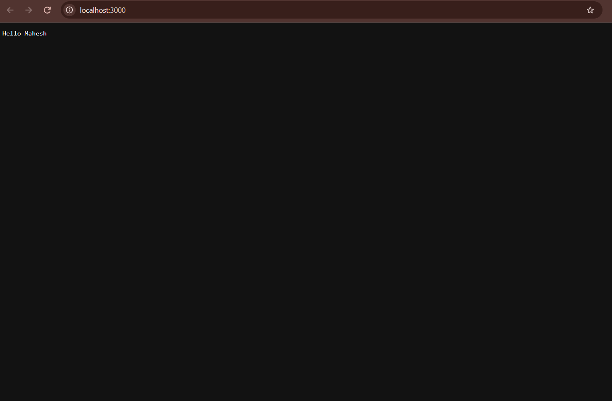
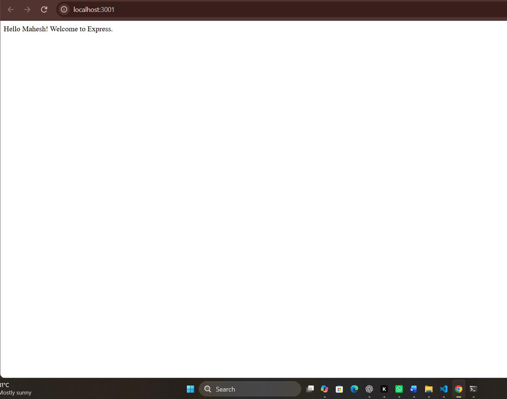
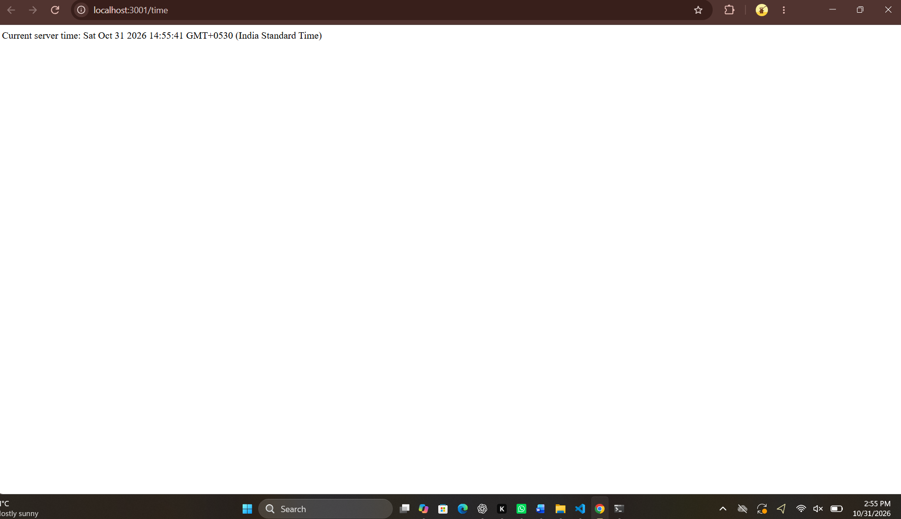
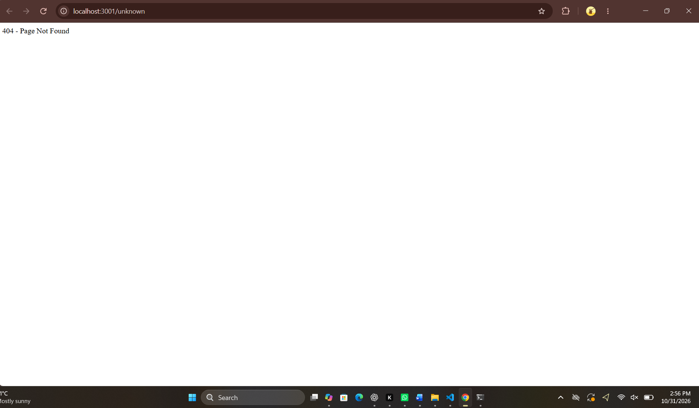

# Backend Development Fundamentals – Lab 1

## Student Details
- **Name:** Mahesh
- **Branch:** CSE Gen AI
- **Section:** S-24

## Objective
To create a basic HTTP server using Node.js and develop an Express server with multiple routes.

## Technologies Used
- Node.js
- Express.js
- JavaScript
- Visual Studio Code

## Project Structure
```text
LAB-1/
├── screenshots/
│   ├── http-server.png
│   ├── express-server.png
│   ├── about.png
│   ├── time.png
│   └── 404-error.png
├── server.js
├── express-server.js
├── package.json
├── package-lock.json
├── .gitignore
└── README.md
```

## Tasks Completed

### 1. Node.js HTTP Server
Created a basic HTTP server using Node.js.

**Screenshot:**



### 2. Express Server
Created an Express server that responds to requests.

**Screenshot:**



### 3. About Route
Displays student information:
- Name: Mahesh
- Branch: CSE Gen AI
- Section: S-24

**Screenshot:**


### 4. Time Route
Displays the current server date and time.

**Screenshot:**



### 5. 404 Error Route
Displays a 404 message when an unknown route is requested.

**Screenshot:**



## How to Run the Project

### Step 1: Install dependencies
```bash
npm install
```

### Step 2: Run the Node.js HTTP server
```bash
node server.js
```
Open: http://localhost:3000

### Step 3: Run the Express server
```bash
node express-server.js
```
Open: http://localhost:3001

## Express Routes

| Route | Description |
|---|---|
| `/` | Home page |
| `/about` | Displays student information |
| `/time` | Displays the current server time |
| `/unknown` | Displays a 404 error |

## Conclusion
Successfully created and tested a basic HTTP server using Node.js and an Express server with multiple routes, including a custom 404 error handler.